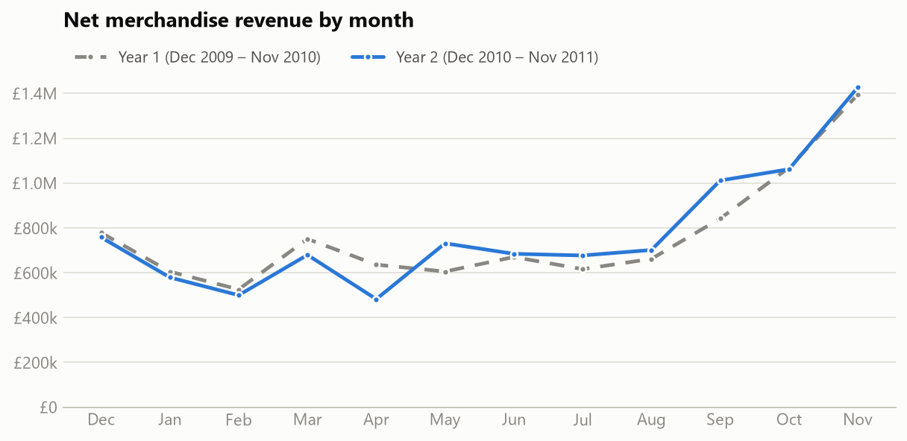
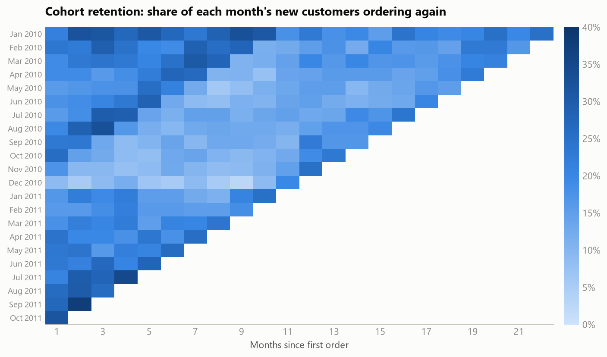
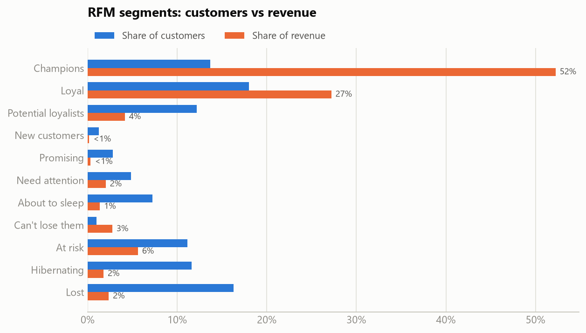
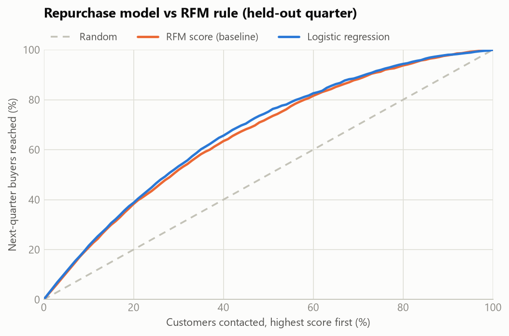

# Who buys, who comes back, and what sells together: e-commerce customer analytics

**[Live dashboard](https://mehtaaarush.github.io/ecommerce-customer-analytics/)** · [Analysis notebook](notebooks/retail_analysis.ipynb)

An end-to-end customer analytics project on two years of transactions from a UK-based online gift retailer: 1,067,371 invoice lines,
December 2009 to December 2011. Cleaning and aggregation run as SQL in DuckDB, modelling in Python, and the results are published as an
interactive dashboard. The project answers the questions a retail analytics team is asked every quarter:

1. **Can the numbers be trusted?** A SQL cleaning step gives every raw line exactly one status, and the counts reconcile to the raw file.
2. **How is the business doing, and where does revenue come from?** Year-on-year KPIs, seasonality, customer mix, countries and product concentration.
3. **Do new customers come back, and who matters most?** Monthly acquisition cohorts and RFM segmentation, with the segments backtested.
4. **Who will order next quarter?** A repurchase-propensity model validated strictly out of time against the RFM rule it would replace.
5. **What sells together?** Market-basket rules (support, confidence, lift) for cross-selling.

## Headline results

- **Clean before counting.** 34,335 exact duplicate lines (£432K, 2.2% of gross product sales) and 9 price keying errors (£42.9K, one of them a
  60-piece picnic basket price charged on each of 60 baskets) are removed; 17,914 cancellations are netted from revenue.
- **Revenue held up on fewer, larger orders.** Net revenue £9.29M in Dec 2010 – Nov 2011 (+1.5%) on 4.0% fewer orders, with the average order
  up 6.3% to £506. September to November bring 38% of the year's revenue.
- **Retention is steady but low.** 21% of new customers order again the next month and 18–22% are active in each of months 1–7.
  A new customer is worth £444 in their first month and £1,380 over their first twelve (3.1×).
- **A third of customers bring four-fifths of revenue.** Champions and Loyal customers are 32% of 5,852 customers and 79% of revenue.
  Scored as of 11 Sep 2011, 83% of Champions ordered within 90 days against 12% of Lost customers. 710 At-risk and Can't-lose customers
  hold £1.37M of past revenue: the win-back list.
- **A repurchase model beats the RFM rule out of time.** A logistic regression on 15 point-in-time features scores ROC AUC 0.802 on a held-out
  quarter against 0.783 for the RFM score (+0.019, 95% CI +0.015 to +0.023), and its top decile ordered at 94% (2.15× the base rate).
  At a 20% campaign size both rankings reach about 70% of next-quarter revenue, so the gain is in ranking quality, not in a different list.
- **Matching sets sell together.** 44,361 product pairs share at least 60 orders. 75% of orders with Poppy's Playhouse kitchen also include
  the matching bedroom, 42 times more often than chance.



## 1. Cleaning in SQL

[`sql/01_clean.sql`](sql/01_clean.sql) classifies every raw line once, in this order:

| Outcome | Lines | Share | Treatment |
|---|---|---|---|
| Product sales | 1,003,329 | 94.0% | Kept (£19.60M gross) |
| Cancellations (invoice starting with C) | 17,914 | 1.7% | Kept and netted from revenue (−£716K) |
| Exact duplicate lines | 34,335 | 3.2% | Removed (£432K) |
| Postage, fees and manual adjustments | 5,823 | 0.5% | Removed |
| Zero-price lines and stock write-offs | 5,961 | 0.6% | Removed |
| Price keying errors (over 100× the product's median price) | 9 | <0.01% | Removed (£42.9K) |

The price-error threshold sits in a clean gap: no sale line is priced between 75 and 100 times its product's median. 22.6% of sale lines have
no customer ID; they count toward revenue and orders but not toward customer metrics.

## 2. Trading performance

| Metric | Dec 2009 – Nov 2010 | Dec 2010 – Nov 2011 | Change |
|---|---|---|---|
| Net revenue | £9.15M | £9.29M | +1.5% |
| Orders | 19,736 | 18,955 | −4.0% |
| Average order value | £476 | £506 | +6.3% |
| Active customer accounts | 4,239 | 4,293 | +1.3% |
| Customers with 2+ orders in the year | 66.4% | 63.8% | −2.5 pp |

- **Seasonality:** September to November bring 38% of year-2 revenue; November alone £1.43M.
- **Customer mix (year 2):** 78% of revenue from returning customers, 7% from customers in their first month, 15% from guest checkouts.
- **Concentration:** the UK brings 85% of revenue; 1,039 of 4,723 products (22%) earn 80% of it.
- **Timing:** orders follow office hours (peak at noon, Thursday the busiest day); the business took 30 Saturday orders in two years.

## 3. Cohort retention



Customers are grouped by the month of their first order and followed through November 2011. Averages are weighted by cohort size.
About one new customer in five orders again in any of the first seven months. Activity sags to 13.5% by month 10 and rebounds to 18.4% at
month 12, when the season that brought them in comes round again. Customers acquired in December 2010 were the least likely to return
(9% in January, against 21% for the average cohort).

## 4. RFM segmentation



Recency and monetary scores are quintiles; frequency uses fixed bands (1, 2, 3–4, 5–9, 10+ orders) because a quarter of customers ordered once.
An 11-segment map of the recency × frequency grid assigns the segment, and each segment gets a recommended action. To check that the segments
mean something, the same scoring was applied as of 11 September 2011 and compared with who ordered in the following 90 days:

| Segment | Customers | Share of revenue | Median days since last order | Median spend | Ordered in the next 90 days (backtest) |
|---|---|---|---|---|---|
| Champions | 801 | 52.2% | 9 | £4,008 | 83% |
| Loyal | 1,053 | 27.2% | 53 | £2,692 | 68% |
| Can't lose them | 58 | 2.8% | 308 | £3,899 | 29% |
| At risk | 652 | 5.6% | 368 | £1,047 | 31% |
| Lost | 952 | 2.4% | 550 | £254 | 12% |

## 5. Repurchase model

Will a customer order again within 90 days? Each row is one customer at one cutoff date, with 15 features computed in SQL from their history
before the cutoff and a label from the 90 days after it. Models are fitted on three quarterly cutoffs, chosen on a fourth (validation), refitted
on all four (17,223 customer-quarters) and scored **once** on the held-out quarter from 11 September 2011 (5,256 customers, 44% of whom ordered).

| Model | Validation PR AUC | Test ROC AUC | Test PR AUC | Brier score | Top-decile lift | Buyers in top 20% | Revenue in top 20% |
|---|---|---|---|---|---|---|---|
| RFM score (baseline) | 0.671 | 0.783 | 0.731 | 0.188 | 2.08× | 38.3% | 69.9% |
| **Logistic regression (selected)** | **0.730** | **0.802** | **0.778** | **0.186** | **2.15×** | **38.8%** | 69.7% |
| Gradient boosting | 0.722 | 0.797 | 0.773 | 0.193 | 2.13× | 38.4% | 69.1% |



- A paired bootstrap of the test quarter (300 resamples) puts the ROC AUC gain over the RFM score at +0.015 to +0.023. The difference in
  revenue reached by the top 20% (−0.8 to +0.9 pp) includes zero.
- Permutation importance: months with an order matter most by far, then orders in the last 90 days. Days since the last order adds almost
  nothing once recent order counts are known.
- The held-out quarter is the Christmas peak: 44% ordered against 35% predicted on average. The ranking holds, but the probabilities should be
  recalibrated on the latest quarter before being read as forecasts.

## 6. Market basket

Among the 400 most-ordered products, every pair bought together in at least 60 orders gives two rules with support, confidence and lift.
The median order holds 15 distinct products and 92% of orders hold more than one, so cross-selling has plenty to work with.

| Product A | Product B | Orders together | Confidence (A → B) | Lift |
|---|---|---|---|---|
| Poppy's Playhouse kitchen | Poppy's Playhouse bedroom | 557 | 75% | 42.2× |
| Set/10 pink polkadot party candles | Set/10 blue spotty party candles | 488 | 60% | 38.0× |
| Feltcraft princess Charlotte doll | Feltcraft princess Lola doll | 401 | 59% | 35.7× |
| Pink polkadot cup | Blue polkadot cup | 521 | 69% | 35.6× |
| Blue polkadot bowl | Pink polkadot bowl | 460 | 66% | 34.5× |

Most of the strongest rules pair a product with its twin in another colour or design: show the twin on the product page and in the basket.
The dashboard has a product picker with the top six "goes with" products for each of the 150 most-ordered items.

## Approach

| Step | Method |
|---|---|
| Data quality | SHA-256 check of the download; one status per raw line in SQL (window functions for exact duplicates, per-product median price for keying errors); counts reconcile to the raw file |
| KPIs | Net revenue, orders, average order value, active customers, repeat rate, revenue mix (new / returning / guest), timing, countries, Pareto concentration |
| Cohorts | Monthly acquisition cohorts; retention and cumulative revenue per customer; size-weighted averages over cohorts old enough to reach each month |
| Segmentation | RFM scores, 11-segment recency × frequency map, out-of-time backtest of each segment's repurchase rate |
| Propensity model | Point-in-time features in SQL (no look-ahead); logistic regression, gradient boosting and an RFM-score baseline; rolling-origin design with validation and test quarters; ROC AUC, PR AUC, Brier score, lift, gains; paired bootstrap intervals; permutation importance |
| Market basket | Pair counts in SQL; support, confidence and lift; strongest pairs and per-product recommendations |
| Delivery | Static dashboard (Plotly) with light and dark themes and a table view for every chart; pytest suite on hand-built transaction sets |

## Project structure

```
ecommerce-customer-analytics/
├── sql/                     # 11 DuckDB queries
│   ├── 01_clean.sql         # one status per raw line
│   ├── 03_monthly.sql       # monthly KPIs and revenue mix
│   ├── 05_cohorts.sql       # cohort activity
│   ├── 06_customer_features.sql   # point-in-time features and 90-day labels
│   ├── 07_basket_pairs.sql  # products bought together
│   └── ...
├── retail/
│   ├── config.py            # paths, source, analysis windows and constants
│   ├── data.py              # download (checksum), Excel to Parquet
│   ├── db.py                # DuckDB connection, runs the cleaning SQL
│   ├── kpis.py              # funnel, monthly and yearly KPIs, timing, products, countries
│   ├── cohorts.py           # retention and value matrices, weighted curves
│   ├── rfm.py               # scoring, segment map, backtest
│   ├── repurchase.py        # out-of-time propensity model, baseline, bootstrap
│   ├── basket.py            # association rules
│   ├── export.py            # dashboard JSON
│   ├── figures.py           # README figures
│   └── pipeline.py          # python -m retail.pipeline
├── tests/                   # 16 tests on small hand-built transaction sets
├── notebooks/retail_analysis.ipynb
├── reports/                 # result tables (CSV) and figures
└── docs/                    # GitHub Pages dashboard (static HTML + Plotly)
```

## Reproduce

```bash
python -m venv .venv
.venv/Scripts/activate        # Windows; use `source .venv/bin/activate` on macOS/Linux
pip install -r requirements.txt
python -m retail.pipeline     # downloads the data once (~46 MB), then rebuilds every output
pytest
python -m http.server 8000 --directory docs   # then open http://localhost:8000
```

## Limitations

- One retailer over two years: the seasonal pattern rests on two Christmases, and many customers are wholesalers, so order sizes and repeat
  rates are not typical of consumer e-commerce.
- Customer-level results describe identified accounts only; 22.6% of sale lines have no customer ID.
- Purchase history before December 2009 is not visible, so "new" means first order in the data, and year-1 revenue is not split into new and returning customers.
- Cancellations are netted by month rather than matched to the original sale line.
- Basket rules are associations, not the causal effect of recommending a product; an A/B test would measure that.

## Data and license

Data: Chen, D. (2012). [Online Retail II](https://doi.org/10.24432/C5CG6D) [Dataset]. UCI Machine Learning Repository, licensed under
CC BY 4.0. The raw data are downloaded on first run and not redistributed here; `docs/data/` and `reports/` hold aggregates derived from them.
Code: MIT License.
